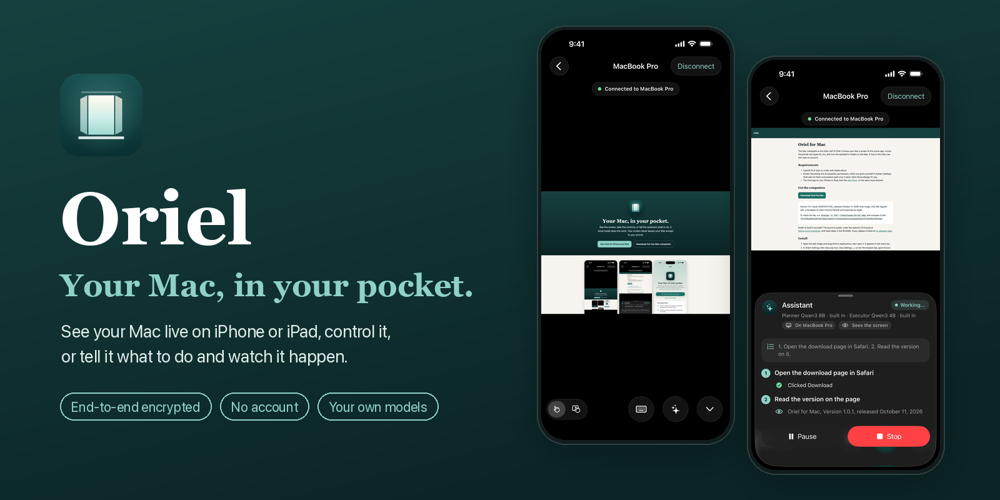
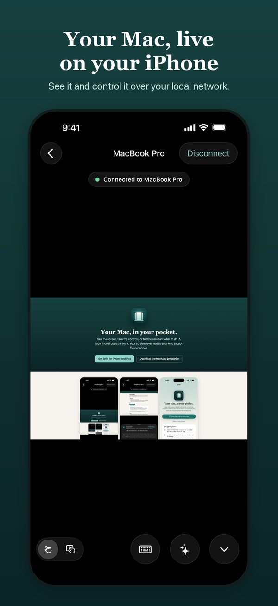
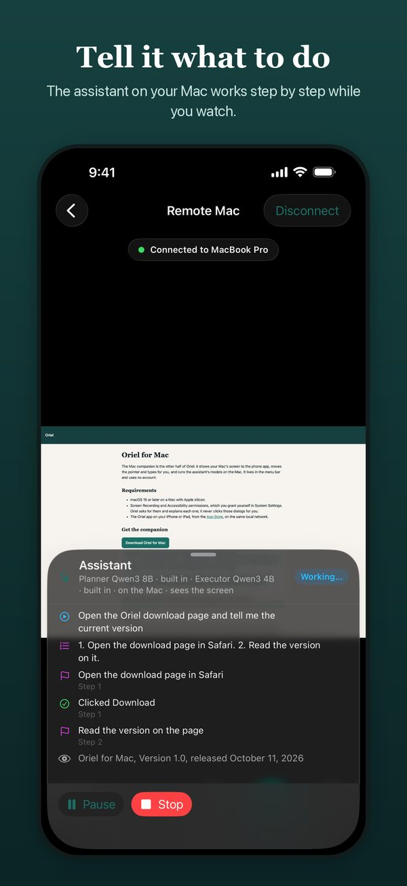
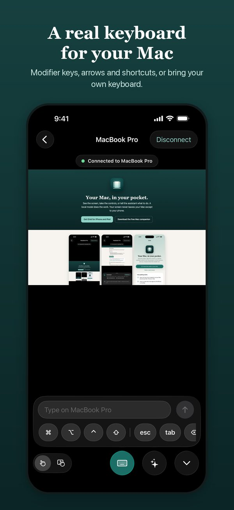
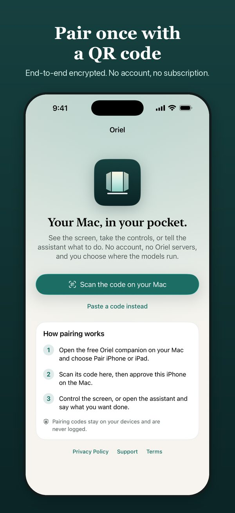
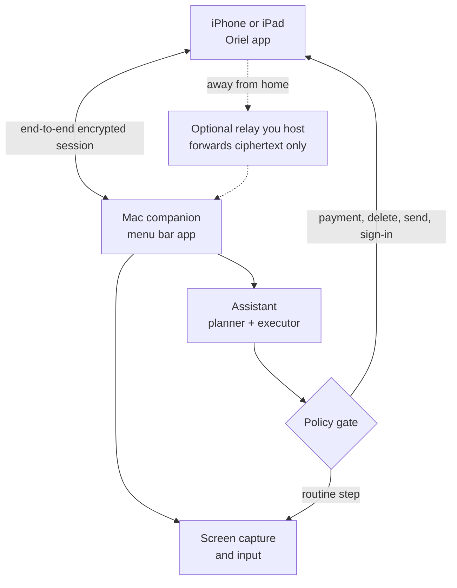

<p align="center">
  
</p>

<p align="center">
  <a href="https://github.com/1ucian/oriel/releases/latest"></a>
  
  
  <a href="LICENSE"></a>
  <a href="https://github.com/1ucian/oriel/stargazers"></a>
</p>

<h3 align="center">Your Mac, in your pocket, with a pair of hands.</h3>

<p align="center">
  See your Mac's screen live on your iPhone or iPad and control it.<br>
  Or tell it what to do, and watch an assistant on your Mac carry it out, step by step.
</p>

<p align="center">
  <a href="https://oriel.67enterprise.com">Website</a> ·
  <a href="https://github.com/1ucian/oriel/releases/latest">Download for Mac</a> ·
    <a href="#how-it-works">How it works</a> ·
  <a href="docs/THREAT_MODEL.md">Threat model</a>
</p>

<p align="center">
  
  
  
  
</p>

## Why Oriel

- **Your real Mac, live.** The screen travels end-to-end encrypted from your Mac to your paired phone, and only there. No account, no subscription, no Oriel servers in the path.
- **Real controls.** Touch or trackpad pointer, taps, double taps, right clicks, drags and scrolling, plus a keyboard tray with modifier keys, arrows and shortcuts. A hardware keyboard, an iPad trackpad or mouse, and a game controller work too.
- **An assistant with hands.** Type or dictate an instruction. A planner breaks it into small steps and a fast executor carries each one out on the Mac while you watch. Pause, stop, answer its questions, or approve a step it is unsure about.
- **Private by construction.** The assistant reads the screen on the Mac itself: the accessibility tree, on-device text recognition, and a downscaled screenshot only for models on your Mac or your own network. A model on the internet gets a text description, never pixels, unless you switch that on for a run. Secure fields and anything that looks like a secret are left out.
- **Hard limits.** The assistant never types passwords, one-time codes or card numbers, and it stops for your approval before payments, deletions, public posts, sign-ins and system security dialogs. Stop Control on the Mac ends everything at once.
- **Your models.** Apple's on-device model, open models built in (they download the first time you use them), Ollama or any OpenAI-compatible server on your network, or a frontier model with your own key. See [docs/MODELS.md](docs/MODELS.md).

## How it works



1. **Pair once.** The Mac shows a signed QR code, the phone scans it, and you approve the phone and the capabilities it asks for on the Mac.
2. **Connect.** Every session is end-to-end encrypted with keys that never leave each device's keychain. Later reconnects on your network need no new approval unless the phone asks for more.
3. **Control or delegate.** Drive the Mac yourself, or hand an instruction to the assistant and approve the steps that need you.

The details: [threat model](docs/THREAT_MODEL.md), [privacy data map](docs/PRIVACY_DATA_MAP.md), [relay tunnel](docs/RELAY_TUNNEL.md), [compatibility](docs/COMPATIBILITY.md).

## Get started

1. Download **Oriel for Mac** from [Releases](https://github.com/1ucian/oriel/releases/latest). It is signed with a Developer ID and notarized by Apple. macOS 15 or later on Apple silicon.
2. Open it and grant Screen Recording and Accessibility when asked. Oriel lives in the menu bar.
3. Install **Oriel** on your iPhone or iPad. The app is coming to the App Store.
4. On the Mac, choose **Pair iPhone or iPad**, scan the code with your phone, and approve it on the Mac.

## Build from source

Requirements: macOS 15 or later, Xcode 26, XcodeGen.

```
swift test                       # protocol and core
xcodegen generate                # the Mac app project
xcodebuild -scheme HermesCaptureMac test
```

## What is here

- `Apps/HermesCaptureMac`: the menu bar companion. Screen capture, input, pairing and approval, the relay host, the assistant runtime and its policy gate, the activity log.
- `Sources/HermesCaptureProtocol`: pairing, reconnect, the encrypted session channel and the relay wire protocol, shared with the phone app.
- `Sources/HermesCaptureCore`: screen observation, the approval policy, display profiles, input mapping.
- `relay/`: the relay server (Python, websockets), with its tests and a Dockerfile.
- `docs/`: models, threat model, privacy data map, compatibility, relay setup.

The iPhone and iPad app is distributed through the App Store and is not part of this repository.

## Contributing

Bug reports, ideas and pull requests are welcome; see [CONTRIBUTING.md](CONTRIBUTING.md). Please report security issues privately, as described in [SECURITY.md](SECURITY.md).

If Oriel is useful to you, a star helps other people find it.

## License

Apache License 2.0; see `LICENSE` and `NOTICE`. "Oriel" and the Oriel icon are trademarks of 67 Enterprise and are not licensed by the Apache License.
